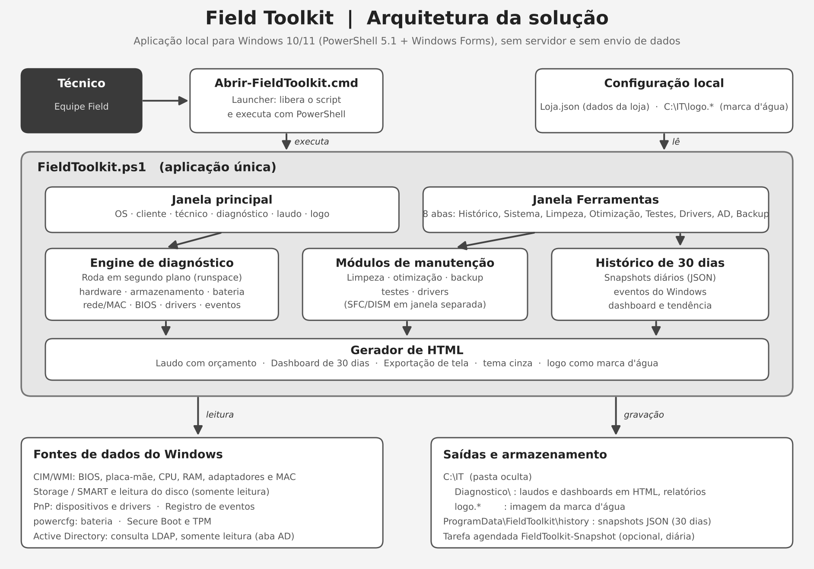

# 🛠️ Field Toolkit | Diagnóstico e Manutenção para Equipes Field Service


Solução portátil e local para Windows que reúne, em uma única interface gráfica, o **diagnóstico completo de bancada** (com geração automática de laudo técnico e orçamento interativo) e uma **caixa de ferramentas de manutenção preventiva e corretiva** para equipes de suporte presencial (Field Service)[cite: 8].

---

## 🎯 Problema Resolvido & Impacto Operacional

No atendimento presencial de suporte de TI, técnicos frequentemente precisam alternar entre dezenas de ferramentas nativas do Windows, anotar informações de hardware manualmente e redigir laudos do zero. 

O **Field Toolkit** padroniza e acelera esse fluxo:
* **Redução do Tempo Médio de Atendimento (TMA):** Coleta automatizada de hardware, sistema, rede e falhas em segundos.
* **Diagnóstico Visual e Preventivo:** Identifica gargalos de disco, falhas de drivers e instabilidades dos últimos 30 dias antes da parada crítica do equipamento[cite: 10, 11].
* **Transparência na Entrega:** Gera relatórios HTML/PDF prontos para o usuário ou gestor, com identidade visual personalizável e tabela de orçamento aprovável[cite: 8, 9, 12].
* **Privacidade e Zero Infraestrutura:** Roda diretamente de uma pasta local ou pendrive, sem exigir instalação, banco de dados ou envio de telemetria para servidores externos[cite: 8, 9].

---

## 🏗️ Arquitetura da Solução

A aplicação foi projetada em camadas desacopladas dentro de um único script PowerShell (`FieldToolkit.ps1`) com interface Windows Forms, executando a coleta pesada em segundo plano (*runspaces*) para manter a interface responsiva[cite: 1, 8, 13].



> 💡 **Nota:** Certifique-se de subir o arquivo `Arquitetura-Field-Toolkit.png` na mesma pasta raiz do `README.md` para que a imagem seja exibida automaticamente acima.

---

## ✨ Principais Funcionalidades

### 1. Diagnóstico Completo & Mapa de Disco (Janela Principal)
* **Inventário de Hardware e Firmware:** Modelo, número de série/Service Tag, UUID, versão/data da BIOS, placa-mãe, processador (com benchmark rápido SHA-256), módulos/slots de RAM, GPU, carga e saúde real da bateria[cite: 9, 10].
* **Segurança e Rede:** Status de *Secure Boot* e *TPM*, adaptadores ativos, endereços IPv4, lista de MACs (físicos e virtuais) e detecção automática do *Low MAC*[cite: 10].
* **Amostragem de Leitura Física do Disco:** Realiza até 128 leituras diretas de blocos no disco do sistema (modo somente leitura via API Win32)[cite: 1], exibindo em tempo real um mapa visual de blocos saudáveis (verde), lentos (amarelo) ou com erro (vermelho)[cite: 1, 15].

### 2. Laudo Técnico e Histórico de 30 Dias (HTML / PDF)
* **Calendário de Estabilidade (30 dias):** Cruza eventos críticos do Windows (*Kernel-Power*, telas azuis/BSOD, desligamentos inesperados e atualizações) para revelar o histórico recente da máquina[cite: 1, 11].
* **Orçamento Interativo:** Permite inserir peças ou serviços no próprio navegador, calcular o total aprovado em tempo real e exportar o documento final via `Ctrl + P` (Salvar como PDF)[cite: 1, 9, 12].
* **Identidade Visual Customizável:** Cabeçalho configurável via `Loja.json` e suporte a marca d'água corporativa (`Logo do laudo`)[cite: 8, 12].

### 3. Caixa de Ferramentas do Técnico (8 Módulos Integrados)
Acessível pelo botão **Ferramentas**, centraliza rotinas administrativas em abas organizadas[cite: 10, 13]:
* **Histórico 30 dias:** Gera um dashboard analítico com gráficos SVG de erros por dia, falhas de aplicativos e tendência de espaço livre em disco (via snapshots diários)[cite: 1, 11].
* **Sistema / BIOS:** Consultas rápidas de hardware, placa-mãe, rede e configurações de *Wake-on-LAN*[cite: 1].
* **Limpeza:** Remoção segura de arquivos temporários, Lixeira, cache do Windows Update e cache DNS[cite: 1, 10].
* **Otimização:** Ativação de plano de energia de alto desempenho, reparo de imagem do sistema (`SFC` e `DISM` em janelas dedicadas), `TRIM` de SSD e análise de processos/inicialização[cite: 1, 10].
* **Testes:** Conectividade de rede/DNS, telemetria SMART do disco, relatório detalhado de bateria (`powercfg`) e diagnóstico de memória[cite: 1, 10].
* **Drivers:** Identificação de dispositivos com erro no Gerenciador de Dispositivos e listagem de drivers ordenados por data[cite: 1, 10].
* **Backup Inteligente:** Cópia incremental em segundo plano utilizando `robocopy`, com suporte a arquivos protegidos (`/B`), modo espelho e geração automática de log[cite: 1, 11].
* **Active Directory (Somente Leitura):** Busca rápida de colaboradores via LDAP/ADSI por matrícula, e-mail, login ou telefone/ramal[cite: 1, 11].

---

## 📦 Estrutura do Pacote

| Arquivo | Descrição |
| :--- | :--- |
| `FieldToolkit.ps1` | Código-fonte principal (interface, engine de diagnóstico, ferramentas e gerador HTML)[cite: 8]. |
| `Abrir-FieldToolkit.cmd` | Inicializador que valida políticas de execução, desbloqueia o script localmente e inicia o app[cite: 8]. |
| `Loja.json` | Arquivo de configuração para personalizar o nome e contato exibidos no cabeçalho do laudo[cite: 8]. |
| `Guia-Field-Toolkit.pdf` | Manual técnico completo de operação e arquitetura da solução[cite: 8]. |

---

## 🚀 Como Executar e Testar

### Requisitos
* Windows 10 ou Windows 11.
* Windows PowerShell 5.1 (nativo no sistema)[cite: 9].

### 🧪 Modo Demonstração (Recomendado para Avaliação)
Para testar a interface, o mapa de leitura do disco e a geração do laudo HTML utilizando **dados fictícios** (sem ler dados reais da sua máquina), execute no PowerShell dentro da pasta extraída[cite: 14]:

```powershell
.\Abrir-FieldToolkit.cmd -Demo
